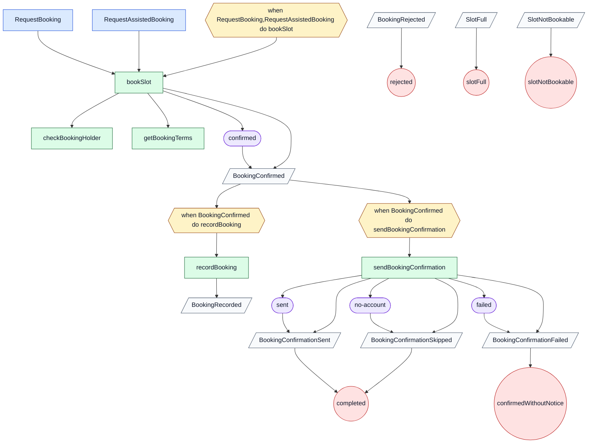

# BUG/1: the ZFL flowchart sends start events past their policy

Reported by the owner on 2026-11-03 from `pista-aberta/architecture/business-flows/book-slot-flow.zfl`. The original report and the complete source are copied below, unchanged, because the original files will be removed. Backlog: [BUG/1](../backlog.md).

The diagram is the Mermaid flowchart that `dsl-views` writes for a ZFL flow, in `dsl-views/src/commonMain/kotlin/io/zenwave360/language/eventflow/view/ZflToMermaidDiagramsTransformer.kt` (tests in `ZflToMermaidDiagramsTransformerTest.kt`).

## Defects seen in the generated Mermaid

1. **Reported.** `start_RequestBooking --> action_bookSlot` and `start_RequestAssistedBooking --> action_bookSlot`: each start goes straight to the action. They should go to the policy that handles them, `policy_when_RequestBooking_RequestAssistedBooking_do_bookSlot`, which already has its edge to `action_bookSlot`.
2. **Each start node is defined twice**, `start_RequestBooking["Citizen"]` and `start_RequestBooking["RequestBooking"]` (the same for `RequestAssistedBooking`). Mermaid keeps the last label, so the actor is lost. One node should carry both, or the actor needs a node of its own.
3. **Duplicate edges.** An action reaches an event both through its outcome node and directly: `action_bookSlot --> outcome_bookSlot_confirmed --> event_BookingConfirmed` and also `action_bookSlot --> event_BookingConfirmed`; the same for the three events of `sendBookingConfirmation`.
4. **Responses not connected.** The outcomes `policy-violated` (`BookingRejected`) and `slot-full` (`SlotFull`) have no node, and `BookingRejected`, `SlotFull` and `SlotNotBookable` only have edges into their terminals, none from `bookSlot`. The handlers on calls (`on SlotNotBookable response BookingRejected`, `on HolderNotEligible response BookingRejected`) are not drawn.
5. **Label.** The policy reads `when RequestBooking,RequestAssistedBooking do bookSlot`, with no space after the comma.

## Handlers that end the command

The source has `on SlotNotBookable response SlotNotBookable // how to shortcircuit this? with return instead of response?` after `call getBookingTerms`. The owner answered on 2026-11-03: an `on` that answers ends the command. That is [BUG/2](bug-2-zfl-on-ends-the-command.md), to do together with this one; defect 4 depends on it. The excerpt in the report below does not have that line; the complete file does.

## Original report (`pista-aberta/zfl-sequence-bug.md`)

````markdown
ZFL flow chart diagram

C:\Users\ivangsa\workspace\pista-aberta\architecture\business-flows\book-slot-flow.zfl
```zfl
flow BookSlotFlow {

    /**
     * Reserva online. El ciudadano elige una franja y acepta las normas de uso.
     */
    @actor(Citizen)
    start RequestBooking {
        unitId String
        startsAt LocalDateTime
        /** Opcional. Integrantes, solo en unidades con aforo. */
        partySize Integer
        /** Opcional. Solo si reserva a nombre de un club del que es miembro. */
        clubId String
        acceptedUsageRulesVersion Integer
    }

    /**
     * Reserva atendida. El vecino llama o se acerca a la instalación, y el
     * personal reserva en su nombre. El titular es un ciudadano o una persona
     * sin cuenta, de la que solo se recogen nombre y teléfono.
     */
    @actor(FacilityStaff)
    start RequestAssistedBooking {
        unitId String
        startsAt LocalDateTime
        /** Opcional. Integrantes, solo en unidades con aforo. */
        partySize Integer
        /** Opcional. Solo si el titular tiene cuenta. */
        citizenId String
        /** Opcional. Solo si el titular no tiene cuenta. */
        guestContact GuestContact
        acceptedUsageRulesVersion Integer
    }

    /**
     * Reserva. Se valida contra las reglas y se ocupan las plazas en una sola
     * transacción, junto con la ocupación de franja.
     *
     * Comprueba aquí las reglas de reserva que dependen de sus propios datos:
     * reservas activas en este concello, contadas aparte para persona y club,
     * antelación máxima, máximo de integrantes y versión vigente de las normas.
     *
     * Si dos personas compiten por la última plaza, la versión de la ocupación
     * deja pasar a una. La otra recibe SlotFull.
     */
    when RequestBooking, RequestAssistedBooking do bookSlot {
        service Bookings.BookingService
        call getBookingTerms
        call checkBookingHolder
        on SlotNotBookable response BookingRejected
        on HolderNotEligible response BookingRejected
        @outcome(confirmed)
        emits response BookingConfirmed
        @outcome("policy-violated")
        response BookingRejected
        @outcome("slot-full")
        response SlotFull
    }

```

start events RequestBooking, RequestAssistedBooking connect directly to bookSlot
they should connect to "when RequestBooking, RequestAssistedBooking do bookSlot" policy


````

## Complete source (`pista-aberta/architecture/business-flows/book-slot-flow.zfl`)

````zfl
config {
    version "0.0.0"
}

systems {

    @zdl("bookings-domain-model.zdl")
    Bookings {
        service BookingService for (Booking, SlotOccupancy) {
            commands: bookSlot
        }
    }

    @zdl("facilities-domain-model.zdl")
    Facilities {
        service FacilityCatalogService for (BookableUnit) {
            commands: getBookingTerms
        }
    }

    @zdl("accounts-domain-model.zdl")
    Accounts {
        service AccountService for (Citizen, Club) {
            commands: checkBookingHolder
        }
    }

    @zdl("notifications-domain-model.zdl")
    Notifications {
        service NotificationService {
            commands: sendBookingConfirmation
        }
    }

    @zdl("analytics-domain-model.zdl")
    Analytics {
        service AnalyticsService {
            commands: recordBooking
        }
    }
}

/**
 * Reservar una franja.
 *
 * Cubre desde que una persona pide una franja hasta que la reserva queda
 * confirmada o rechazada. Hay dos canales: online, hecha por el ciudadano, y
 * atendida, hecha por el personal de instalación en nombre de un vecino.
 *
 * La reserva se confirma al instante. No hay aprobación ni pago, así que no
 * existe un estado pendiente ni una compensación.
 *
 * Todo lo que decide si se puede reservar es síncrono y ocurre antes de
 * confirmar. Los avisos y los indicadores van después, por eventos: una reserva
 * no falla porque no salga un correo.
 */
flow BookSlotFlow {

    /**
     * Reserva online. El ciudadano elige una franja y acepta las normas de uso.
     */
    @actor(Citizen)
    start RequestBooking {
        unitId String
        startsAt LocalDateTime
        /** Opcional. Integrantes, solo en unidades con aforo. */
        partySize Integer
        /** Opcional. Solo si reserva a nombre de un club del que es miembro. */
        clubId String
        acceptedUsageRulesVersion Integer
    }

    /**
     * Reserva atendida. El vecino llama o se acerca a la instalación, y el
     * personal reserva en su nombre. El titular es un ciudadano o una persona
     * sin cuenta, de la que solo se recogen nombre y teléfono.
     */
    @actor(FacilityStaff)
    start RequestAssistedBooking {
        unitId String
        startsAt LocalDateTime
        /** Opcional. Integrantes, solo en unidades con aforo. */
        partySize Integer
        /** Opcional. Solo si el titular tiene cuenta. */
        citizenId String
        /** Opcional. Solo si el titular no tiene cuenta. */
        guestContact GuestContact
        acceptedUsageRulesVersion Integer
    }

    /**
     * Reserva. Se valida contra las reglas y se ocupan las plazas en una sola
     * transacción, junto con la ocupación de franja.
     *
     * Comprueba aquí las reglas de reserva que dependen de sus propios datos:
     * reservas activas en este concello, contadas aparte para persona y club,
     * antelación máxima, máximo de integrantes y versión vigente de las normas.
     *
     * Si dos personas compiten por la última plaza, la versión de la ocupación
     * deja pasar a una. La otra recibe SlotFull.
     */
    when RequestBooking, RequestAssistedBooking do bookSlot {
        service Bookings.BookingService
        call getBookingTerms
        on SlotNotBookable response SlotNotBookable // how to shortcircuit this? with return instead of response?
        call checkBookingHolder
        on SlotNotBookable response BookingRejected
        on HolderNotEligible response BookingRejected
        @outcome(confirmed)
        emits response BookingConfirmed
        @outcome("policy-violated")
        response BookingRejected
        @outcome("slot-full")
        response SlotFull
    }

    /**
     * Comprueba que la franja existe según la plantilla en vigor de la unidad y
     * devuelve el aforo, las reglas de reserva efectivas (las del concello o las
     * de la unidad, si las sobrescribe) y la versión vigente de las normas de uso.
     */
    do getBookingTerms {
        service Facilities.FacilityCatalogService
        response BookingTermsResult
        response SlotNotBookable
    }

    /**
     * Comprueba que el titular puede reservar. Si reserva a nombre de un club,
     * que la asociación esté aprobada por el gestor municipal. No aplica a una
     * persona sin cuenta.
     */
    do checkBookingHolder {
        service Accounts.AccountService
        response HolderEligibleResult
        response HolderNotEligible
    }

    /**
     * Aviso de confirmación por correo, con iCalendar adjunto. Una persona sin
     * cuenta no recibe aviso: el personal le da los datos en ese momento. Si el
     * correo falla, la reserva sigue confirmada.
     */
    when BookingConfirmed do sendBookingConfirmation {
        service Notifications.NotificationService
        @outcome(sent)
        emits BookingConfirmationSent
        @outcome("no-account")
        emits BookingConfirmationSkipped
        @failure @outcome(failed)
        emits BookingConfirmationFailed
    }

    /**
     * Indicadores. Registra la reserva por unidad, franja, canal de reserva y uso
     * por vecinos y foráneos, según el dato declarado.
     */
    when BookingConfirmed do recordBooking {
        service Analytics.AnalyticsService
        emits BookingRecorded
    }

    end {
        completed: BookingConfirmationSent, BookingConfirmationSkipped
        confirmedWithoutNotice: BookingConfirmationFailed
        rejected: BookingRejected
        slotFull: SlotFull
        slotNotBookable: SlotNotBookable
    }
}

````